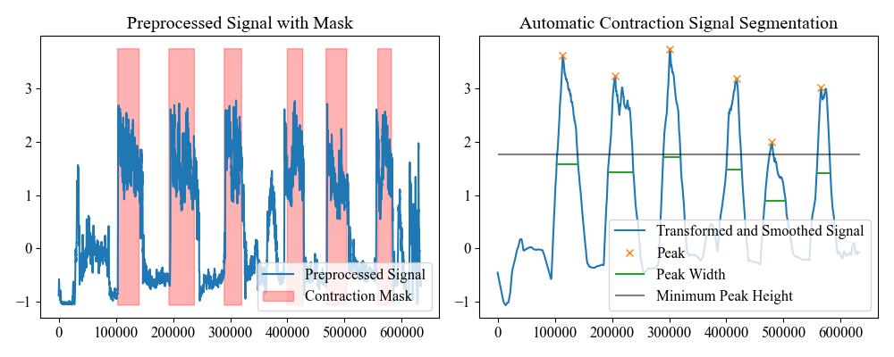

# EMG Contraction Extraction & Classification

Official code for **"Proof-of-concept: differentiating upper trapezius muscle with
myofascial trigger point using deep learning model on a small prospective sEMG dataset"**
(*Journal of Electromyography and Kinesiology*, 2026).

Hao-En Lu, David Koivisto, Zixue Zeng, Tong Yu, Jing Wang, Xin Meng, Richard Wilson,
Dinesh Kumbhare, Jiantao Pu

The code automatically extracts voluntary-contraction segments from 64-channel
high-density surface EMG (HD-sEMG) recordings of the upper trapezius and trains a
deep-learning model that classifies **healthy** muscles versus muscles with
**myofascial trigger points** (latent or active MTrP), evaluated with subject-level
K-fold cross-validation.

Developed at the Beyond Vision Laboratory, University of Pittsburgh.

<p align="center"></p>

## Pipeline

```
raw HD-sEMG (64 × T, 4 kHz)
  │  extract_segments.py
  │    band-pass 10–500 Hz → sliding RMS (800) → outlier removal (95th pct) → z-score
  │    → pre-intervention period → channel-mean envelope → sign(x)|x|^γ → moving average
  │    → peak detection + peak widths → contraction mask → contraction segments
  ▼
segments/<subject>/segment-<i>.npy
  │  train.py   (CNN1D on each segment resampled to 8000 samples, subject-level 5-fold CV × 5 runs)
  ▼
outputs/<run>/run_<r>/fold_<k>/checkpoint_best.pth
  │  evaluate.py
  ▼
segment- and subject-level AUC / ACC / F1 / MCC (mean, 95 % CI) + ROC curves
```

## Installation

```bash
git clone <this-repo>
cd <this-repo>
python -m venv .venv && source .venv/bin/activate   # Windows: .venv\Scripts\activate
pip install -r requirements.txt                     # install a CUDA build of PyTorch first if you have a GPU
```

## Data

The participant recordings are **not** distributed with this repository.

* **Raw EMG**: one file per subject in `<data_dir>`, either `<SUBJECT>.npy` or
  `<SUBJECT>-<timestamp>.DATA_RAW.mat` (MATLAB variable `data`), with shape
  `(64, n_samples)` sampled at 4 kHz.
* **Labels**: a CSV with columns `subject` and `Type`, where `Type` is one of
  `Healthy` (label 0), `Latent` or `Active` (label 1). See [labels_template.csv](labels_template.csv).
  Any extra columns are ignored.

## Usage

### 1. Extract contraction segments

```bash
python extract_segments.py --data_dir data/raw --output_dir data/segments_pre_800 --plot
```

Writes `segment-<i>.npy` arrays per subject, an `extraction_summary.csv`
(segments and seconds of contraction per subject), the parameters used, and a
diagnostic figure per subject with `--plot`. All parameters are exposed as flags
(`python extract_segments.py -h`); the defaults are the ones used in the study:

| Parameter | Flag | Default |
|---|---|---|
| Band-pass | `--lowcut / --highcut` | 10 / 500 Hz |
| RMS window | `--rms_window` | 800 samples (0.2 s) |
| Outlier removal | `--outlier_percentile` | 95 (time points where any channel exceeds it are dropped) |
| Analysed period | `--period` | `pre` (pre-intervention) |
| Pre/post split threshold | `--active_percentile` | 90 |
| Split extension | `--active_extension` | 4000 samples |
| Smoothing window | `--smooth_window` | 20 000 samples (5 s) |
| Scaling exponent γ | `--gamma` | 2.0 |
| Min. peak height | `--peak_percentile` | 75th percentile |
| Width measured at | `--peak_rel_height` | 0.5 |
| Min. peak width | `--peak_min_width` | 12 000 samples |

Recording-specific fixes (e.g. discarding the first 200 000 samples of `S0013`) are in
`PreprocessParam.manual_crop` in [emgnet/signal.py](emgnet/signal.py).

### 2. Train

```bash
# CNN1D classifier, pairwise ranking loss, 5-fold CV, 5 repeated runs
python train.py --loss pairwise --segment_dir data/segments_pre_800 --labels labels.csv

# Loss comparison
python train.py --loss bce     --segment_dir data/segments_pre_800 --labels labels.csv
python train.py --loss combine --segment_dir data/segments_pre_800 --labels labels.csv
```

Key options (`python train.py -h` for all):

| Option | Default | Description |
|---|---|---|
| `--loss` | `pairwise` | `pairwise` (pairwise logistic / AUC ranking), `bce`, or `combine` (weighted sum) |
| `--segment_length` | 8000 | Each contraction segment is Fourier-resampled to this length |
| `--n_splits`, `--seed` | 5, 121 | Subject-level K-fold split |
| `--runs` | 5 | Repeated trainings with different initialisations |
| `--selection` | `test_fold` | Data used to pick the best epoch (see [notes](#reproducibility-notes)) |
| `--epochs`, `--batch_size`, `--lr` | 20, 80, 1e-3 | Optimisation (Adam, β = (0.9, 0.99)) |
| `--dropout` | 0.5 | Dropout after each convolution |
| `--augment` | off | Channel permutation, magnitude warping and Gaussian noise (not used in the paper) |

Folds are split by **subject**, so no subject contributes segments to both training and
test.

### 3. Evaluate

```bash
python evaluate.py --checkpoint_dir outputs/cnn1d_segments_pre_800_121_5_noaug_loss_pairwise \
    --segment_dir data/segments_pre_800 --labels labels.csv
```

Metrics are computed per (run, fold) split at two levels:

* **segment level** - every contraction segment is scored separately;
* **subject level** - a subject's score is the mean probability of its segments.

For each level the script reports the mean over the 25 splits with a Student-t and a
bootstrap 95 % confidence interval, and writes `per_fold_metrics.csv`, `summary.json`,
`roc_segment.png` and `roc_subject.png` to `<checkpoint_dir>/evaluation/`.

### Reference results

CNN1D with the pairwise loss on `segments_pre_800` (22 subjects, 5-fold CV × 5 runs),
mean over the 25 splits with Student-t 95 % CI:

| Level | AUC | ACC | F1 | MCC |
|---|---|---|---|---|
| Segment | 0.835 [0.774, 0.896] | 0.819 [0.768, 0.870] | 0.848 [0.808, 0.889] | 0.661 [0.574, 0.747] |
| Subject | 0.940 [0.888, 0.992] | 0.960 [0.926, 0.994] | 0.960 [0.926, 0.994] | 0.933 [0.877, 0.990] |

## Model

`CNN1D` takes a 64-channel contraction segment resampled to 8000 samples and applies
4 × [Conv1d(k=3, stride=2) → ReLU → Dropout(0.5)] with 16/32/64/128 filters, followed
by an MLP 1024 → 64 → 1 that outputs one logit (healthy vs. MTrP).

## Repository layout

```
emgnet/
  signal.py     preprocessing and contraction extraction
  data.py       contraction-segment dataset and label loading
  augmentation.py  optional training-time augmentations
  models.py     CNN1D classifier
  losses.py     pairwise logistic, combined losses
  metrics.py    AUC/ACC/MCC/F1, ROC interpolation, confidence intervals
  utils.py      subject K-fold, checkpoints, seeding
extract_segments.py   step 1
train.py              step 2
evaluate.py           step 3
```

## Reproducibility notes

* **Model selection.** By default (`--selection test_fold`) the checkpoint kept for each
  fold is chosen by monitoring loss/AUC on that fold's held-out subjects, which reproduces
  the original experiments. This uses test-fold information and gives optimistic
  estimates. For an unbiased estimate use `--selection inner_val`, which holds out a
  stratified subset of the training subjects for model selection.
* **Thresholded metrics.** ACC, F1 and MCC are reported at the Youden-optimal threshold
  of each test split, so they are optimistic. AUC is threshold-free.

## License

Released under the [MIT License](LICENSE).
Copyright (c) 2026 Beyond Vision Laboratory, University of Pittsburgh.

## Citation

If you use this code, please cite:

```bibtex
@article{lu2026proof,
  title   = {Proof-of-concept: differentiating upper trapezius muscle with myofascial trigger point using deep learning model on a small prospective sEMG dataset},
  author  = {Lu, Hao-En and Koivisto, David and Zeng, Zixue and Yu, Tong and Wang, Jing and Meng, Xin and Wilson, Richard and Kumbhare, Dinesh and Pu, Jiantao},
  journal = {Journal of Electromyography and Kinesiology},
  year    = {2026}
}
```
